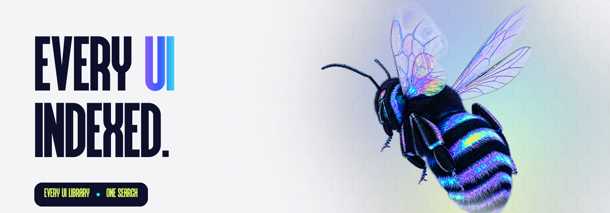

<div align="center">



<br />
<br />

**Every UI library on the internet, in one searchable index.**

Find the right component library for your stack in seconds. Filter by framework, by kind, or just type what you need.

<br />

[](https://nextjs.org)
[](https://react.dev)
[](https://www.typescriptlang.org)
[](https://tailwindcss.com)

[](src/data/libraries.ts)
[](#-feed-the-hive)

</div>

<br />

## 🐝 What is Uindex?

There are thousands of UI libraries scattered across the web: headless primitives, styled kits, copy-paste blocks, animation packs, chart and icon sets, for every framework you can think of. **Uindex gathers them into one fast, searchable index**, so you spend less time hunting and more time building.

No sign-ups. No backend. Just search.

<br />

## ✨ Features

| | |
|---|---|
| 🔎 **Instant search** | Matches names, descriptions, kinds and frameworks as you type. Press <kbd>/</kbd> from anywhere to jump into it. |
| 🧩 **Framework filters** | One tap for React, Vue, Svelte, Solid, Angular, Web Components, HTML/CSS, React Native or Flutter. |
| 🗂️ **Kind tabs** | Headless · Styled kit · Copy-paste · CSS framework · Motion · Mobile · Charts · Icons, sticky while you scroll. |
| 🔗 **Shareable searches** | `/?q=headless` opens the index with the search already filled in. |
| 📱 **Responsive** | Designed for phones first, from 360px up to ultrawide. |
| ♿ **Accessible** | Semantic headings, labelled controls, visible focus rings, and `prefers-reduced-motion` respected. |
| 🚀 **Static and fast** | The whole index is prerendered to HTML, so search engines and slow phones see every library without running JavaScript. |

<br />

## 📈 SEO, built in

- Full metadata: title template, description, keywords, canonical URL, Open Graph and Twitter cards
- **Generated 1200×630 social preview** (`/opengraph-image`) in the brand font
- `robots.txt`, `sitemap.xml` and a web app manifest, all generated from code
- **JSON-LD structured data**: `WebSite` with a `SearchAction` (for a sitelinks search box), `Person`, and an `ItemList` of every indexed library
- Favicon set: SVG, multi-size `.ico`, Apple touch icon, PWA and maskable icons

Every SEO value comes from one file: [`src/lib/site.ts`](src/lib/site.ts).

<br />

## 🚀 Getting started

```bash
git clone https://github.com/LovekeshAnand/uindex.git
cd uindex
npm install
npm run dev
```

Open [http://localhost:3000](http://localhost:3000) and start searching.

| Script | What it does |
|---|---|
| `npm run dev` | Start the dev server |
| `npm run build` | Production build (prerenders everything) |
| `npm run start` | Serve the production build |
| `npm run lint` | Run ESLint |

### Environment

| Variable | Default | Purpose |
|---|---|---|
| `NEXT_PUBLIC_SITE_URL` | `https://uindex.vercel.app` | Production domain used for canonical URLs, the sitemap, social cards and JSON-LD. **Set this before deploying.** |

<br />

## 🍯 Feed the hive

Missing a library? Add it to [`src/data/libraries.ts`](src/data/libraries.ts) and open a PR:

```ts
{
  name: "Your Library",
  url: "https://your-library.dev",
  kind: "Headless", // Headless | Styled kit | Copy-paste | CSS framework | Motion | Mobile | Charts | Icons
  frameworks: ["React", "Vue"],
  description: "One short line on what makes it worth using.",
},
```

That's it. The search, tabs, counts, ticker, sitemap and structured data all update from that one list.

<br />

## 🗺️ Project structure

```
src/
├── app/
│   ├── layout.tsx            # fonts + site-wide metadata
│   ├── page.tsx              # page shell, nav, JSON-LD
│   ├── globals.css           # theme tokens, gradients, grain, animations
│   ├── opengraph-image.tsx   # generated social card
│   ├── sitemap.ts · robots.ts · manifest.ts
│   ├── icon.svg · favicon.ico · apple-icon.png
│   └── fonts/Urbanic.otf
├── components/
│   ├── Explorer.tsx          # hero, search, filters, tabs, index list
│   ├── Footer.tsx
│   └── Logo.tsx
├── data/libraries.ts         # ← the index
└── lib/site.ts               # SEO + site config
```

<br />

## 🎨 Design

- **Type:** *Urbanic* for display, *Instrument Sans* for body text, *JetBrains Mono* for small labels
- **Palette:** taken from the iridescent bee:

| Ink | Blue | Cyan | Lime | Paper |
|:---:|:---:|:---:|:---:|:---:|
|  |  |  |  |  |

<br />

## 🧑‍💻 Author

Built by **[Lovekesh Anand](https://github.com/LovekeshAnand)**.

If Uindex saved you some searching, a ⭐ on the repo helps more people find it.

<div align="center">
<br />


<sub>Bzz.</sub>

</div>
